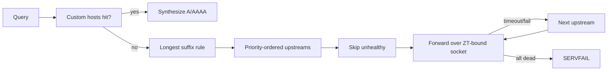
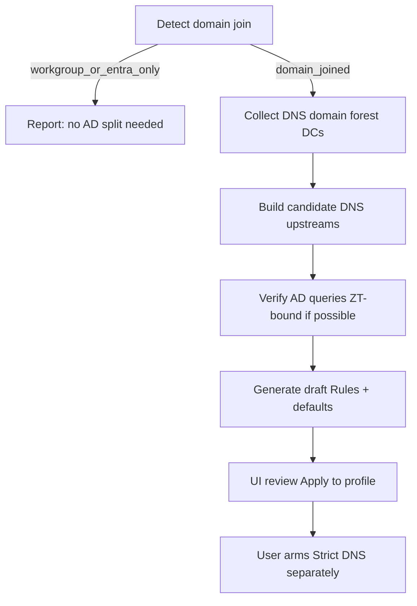
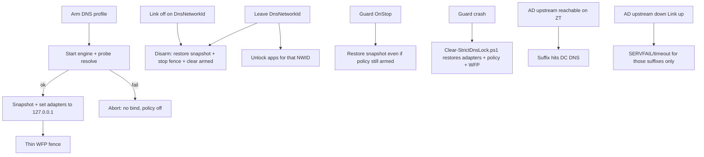

# ZT-AppLocker v5.0 — Guard-hosted split DNS (design)

> **Status:** Design committed on branch `v5/guard-split-dns`. Implementation not started.
> **Stable line:** v4.0 remains the shippable baseline (`Build-ZTAppLocker-v4.ps1`, AssemblyVersion `4.0.0.0`).
> **One-liner:** Replace WFP/NIC Strict DNS with a Guard-hosted DNS forwarder (split/conditional forwarding, validate-on-add, continuous health, AD domain probe, global Advanced UI) without bricking OS DNS.
# Guard-hosted split DNS engine

## Verdict

Migrate Strict DNS from “push controller DNS onto ZT NIC + WFP block non-ZT :53” to an in-process **DnsEngine** inside `ZTAppLockerGuard`, with system DNS pointed at `127.0.0.1`, conditional forwarders for AD zones, and disarm/restore that never leaves a dead loopback resolver.

## Versioning (preserve stable v4)

| Track | Role |
|---|---|
| **v4.0** | Latest **stable** line — leave current sources/build (`Build-ZTAppLocker-v4.ps1`, `AssemblyVersion 4.0.0.0`, `dist/ZT-AppLocker.exe`, Guard “v4.0” strings) untouched as the shippable baseline. |
| **v5.0** | This Guard split-DNS approach — new development track; bump assembly/file version to `5.0.0.0`, Guard/UI/CLI banners to “v5.0”, add `Build-ZTAppLocker-v5.ps1` (and CI job/artifact name) when implementation starts. |

**Git layout:**
- Branch from current stable: `v5/guard-split-dns` (do not force-push main/master).
- Commit into the repo a durable plan copy: [`docs/v5-guard-split-dns.md`](docs/v5-guard-split-dns.md) (content from this plan) + short pointer in README under “v5 (in development)”.
- Keep v4 build script and v4 docs as the default “stable” story until v5 is released.
- Tag only after v5 is buildable; until then branch + docs only.

**Bootstrap:** Branch `v5/guard-split-dns`; this document is the durable plan copy.


## Decisions (locked)

| Decision | Choice |
|---|---|
| System hook | **Adapter DNS → `127.0.0.1`** on physical + ZT adapters (snapshot before change). Engine owns split; no NRPT dependency in v1. |
| Listen | **`127.0.0.1:53` UDP+TCP** in Guard (LocalSystem). |
| Engine | **Embed lightweight C# forwarder** in-repo (no NuGet, no external dnsmasq/Unbound). Matches “zero NuGet runtime deps”. |
| DNS UI scope | **Global** setting — not a per-network row control. Remove the Strict DNS column/toggle from the Networks table entirely. |
| ZT path for DNS | Global profile still has optional `NetworkId` (dropdown in DNS settings) used for PreferZtBind / thin fence GUID / Link-off disarm — selected in the global DNS panel, not by clicking a network row. |
| Multi-network | One global `DnsProfile` (armed or not). At most one preferred ZT `NetworkId` for tunnel-bound upstreams. |
| AD zone source | **Detect & propose** via `DnsDomainProbe` wizard + manual edit; controller `dns.servers` still seed default upstreams. Never silent auto-arm from probe alone. |
| Link-off AD | **Disarm** profile (restore snapshot, stop fence) — same safety as today. **Do not** auto-restore on Link reconnect. Fail-closed while armed; no LAN-DNS soft leak while armed. |
| WFP after | **Thin fence only**: block outbound :53 from non-loopback/non-ZT local addresses; permit loopback; engine forwards to upstreams over ZT. Retire “WFP *is* Strict DNS”. |
| Custom upstreams | First-class editable list (not only controller seed); controller DNS is a **seed**, user can add/reorder/remove. |
| Upstream gate | **Every** upstream (custom, controller-seeded, AD/DC, probe-generated) must **validate before accept** and stay on continuous health monitor — no unmonitored servers in the profile. |
| Priority / failover | Ordered upstream lists (lower `Priority` = prefer first); query + monitor drive failover; skip unhealthy. |
| Health monitor | **Always-on while profile is loaded/armed** (and on add/edit); constant availability detection; sticky unhealthy/recovery. |
| Outage survival | Engine keeps listening on `127.0.0.1:53`; hosts still answer; failover within pools; SERVFAIL if pool exhausted; **never** silent LAN DNS fallback; OS bind stays until explicit disarm/Link-off/extinguisher. |
| Custom hosts | Local A/AAAA overrides answered before any forward (hosts-file style). |

## Engine capabilities (complements)

Resolution order for each query:



### Custom DNS servers + mandatory validation
- Profile holds **default upstream list** and per-rule upstream lists as `DnsUpstream { Address, Port=53, Priority, PreferZtBind, LastValidatedUtc, Enabled }`.
- **Add/edit gate (blocking):** before a server is saved into the profile (UI custom add, controller seed merge, domain-probe Apply, CLI), run `ValidateUpstream`:
  - Reachable UDP/53 (TCP if needed) with correct bind mode (`PreferZtBind` → ZT local IP when Link up).
  - Returns a usable DNS response for the probe name (default pool: recursive smoke name; AD rule: SOA/NS or configured `HealthProbeName`).
  - RTT recorded; failure → reject add with error (or save as `Enabled=false` + red badge only if user explicitly chooses “Add anyway disabled” — **chosen default: reject until validation passes**).
- Re-validate on arm: any enabled upstream that fails validation at arm time is marked unhealthy and skipped; arm still requires **≥1 validated healthy default upstream**.
- UI: add IP (hostname resolved once at edit time to IP), reorder, enable/disable; disabled servers stay listed but are not queried until re-validated enable.

### Server priority
- Stable sort by `Priority` ascending, then list order.
- Query path: try **healthy+enabled** servers in order; per-attempt timeout ~800ms (UDP), then next; TCP on TC.
- Do **not** round-robin by default (predictable AD/corp behavior).

### Continuous availability monitor (`DnsUpstreamMonitor`) — outage survival
- **Scope:** every enabled upstream in default + all rules; no exceptions for “trusted” custom servers.
- **When:** starts with engine when profile armed; also runs a one-shot validate on add; continues for the whole armed lifetime (timer ~5–15s, faster retry ~2s while a server is freshly unhealthy).
- **Probe:** UDP query for pool `HealthProbeName` (defaults: recursive smoke for default pool; rule suffix / SOA for AD pools). Treat timeout, ICMP unreachable, REFUSED, and SERVFAIL-as-transport-failure as down; NXDOMAIN on the smoke name can still count as “server alive” for recursive pools.
- **State machine:** Failure streak ≥2 → `Unhealthy` (skipped by forwarder); success streak ≥2 → `Healthy` (anti-flap). Forwarder also feeds soft-fail signals (query timeouts) into the same counters.
- **Outage survival (engine must not die):**
  - Listener on `127.0.0.1:53` stays up through upstream outages.
  - Custom **hosts** keep answering (break-glass names still work).
  - Per-pool failover to next healthy upstream; cross-pool isolation (AD down ≠ internet down).
  - All upstreams in a pool dead → SERVFAIL for that class of names only; log + UI red.
  - All **default** upstreams dead sustained (~60s): critical Guard log + UI alert; **keep OS bind** (fail closed, no LAN leak); do not crash/stop engine; do not auto-disarm (user/Link-off/extinguisher/disarm only) — avoids flapping restore during transient WAN DNS blips.
- Status: Guard log + `dns-status.json` badges (green/amber/red, last RTT, last error) for every server.

### Custom hosts
- `DnsHostEntry { Name, IpAddresses[] }` — exact and optional `*.suffix` wildcards for A/AAAA only.
- Answer authoritatively from engine (AA bit unset is fine); never forward those QNAMEs.
- Use cases: pin DC/app aliases, lab names, break-glass when AD DNS is slow.
- UI: simple name → IP grid; import optional later (not v1).

### Domain-join detect & split generator (`DnsDomainProbe`)

**Opinion / design choice:** Yes — this is the highest-leverage UX for AD coexistence. Manual suffix/DC entry is where most misconfigs and bricks start. Ship it as a **wizard that proposes a draft profile the user reviews**, not as silent policy mutation or auto-arm.



**Detect**
- Join state via `NetGetJoinInformation` (Domain vs Workgroup).
- DNS domain from join info + `USERDNSDOMAIN` / Tcpip `Domain` / `NV Domain` as fallbacks.
- Entra ID–only (no classic AD): detect via `HKLM\SYSTEM\CurrentControlSet\Control\CloudDomainJoin` / dsreg-style markers; wizard exits with clear “Entra-joined only — AD split DNS not applicable” (hybrid domain-joined still proceeds).

**Collect configuration**
- Forest/domain DNS names when available (`Domain.GetComputerDomain` / DsRole — best-effort; degrade gracefully if offline).
- DC locator: `DsGetDcName` + DNS SRV `_ldap._tcp.dc._msdcs.<domain>` (and forest `_msdcs` if distinct).
- Candidate DNS IPs: DC addresses that answer DNS; current adapter DNS servers that successfully resolve AD probe names; ZT controller `dns.servers` for the selected network.

**Verify (must pass before “Apply” enables)**
- Against each candidate upstream (prefer **ZT-bound** socket when the DNS profile’s network Link is up):
  - SOA or NS for `<dnsDomain>`
  - A/AAAA for discovered DC hostnames
  - SRV `_ldap._tcp.dc._msdcs.<dnsDomain>`
- Record per-candidate: reachable, RTT, which checks passed.
- Prefer candidates that pass **over ZT**; demote or warn on LAN-only DCs (leak risk once Strict is armed).

**Generate draft split config**
- Rules (priority-ordered upstreams, `PreferZtBind=true`):
  - `<dnsDomain>`
  - `_msdcs.<dnsDomain>`
  - forest root / `_msdcs.<forest>` if different from domain
- Default upstreams: ZT controller DNS seed, else current non-AD recursive servers (exclude DC IPs already used in AD rules when they are AD-only).
- Optional hosts suggestions: none by default; may suggest pinning a DC short name if NetBIOS≠FQDN resolution is flaky (user opt-in).
- Output is a **draft** merged into the profile editor; user can edit before arm. Probe never sets `Armed=true`.

**UI / CLI**
- Profile editor button: **Detect domain / Generate split**.
- Progress + results panel: join state, domain, DCs, verification matrix, generated rules.
- CLI (optional same pass): `--dns-probe [nwid]` prints JSON draft; `--dns-probe-apply` only with explicit flag after print (or UI-only apply — **chosen: UI Apply + CLI print draft**; apply remains UI/`--set-dns-lock` arm path).

### Other ideas — in scope vs deferred

**In scope with this engine work**
- Query debug counters in Guard log (forwarded / hosts-hit / upstream-fail) — no PII dump by default; optional verbose QNAME logging behind a policy flag.
- Respect upstream TTL for a small positive response cache (cap ~256 entries, max TTL 300s) to cut AD locator chatter.
- TCP fallback when UDP truncated (TC bit) — needed for large AD SRV responses.
- Domain probe wizard (detect → verify → draft rules).

**Deferred (explicit non-goals for this pass)**
- DoH/DoT, DNSSEC validation, full recursive resolver, blocklists/adblock, NRPT UI, per-process DNS, mDNS/LLMNR hijack.
- Silent auto-arm from probe; continuous re-probe that rewrites live rules without user action.

## Threat / behavior matrix



| State | App locks | System DNS | Engine | WFP fence |
|---|---|---|---|---|
| Strict/profile on, Link up | unchanged | `127.0.0.1` (snapshotted) | running, split rules | thin on |
| Link off (DNS NWID) | stay armed / fail-closed | **restored** | stop / not re-armed | off; policy armed cleared |
| Leave DNS NWID | unlock that NWID | restored | stop | off |
| Guard stop (clean) | unchanged | **restored** | stop | off (best-effort) |
| Guard crash | unchanged | stuck on 127.0.0.1 until extinguisher / restart heal | dead | may linger until clear |
| Guard restart + policy armed + Link up | unchanged | re-verify then re-bind | re-start | re-arm |
| Guard restart + cannot verify | unchanged | leave/restore usable DNS; clear armed | off | off |
| Multiple joined nets | per-app | one exclusive DNS profile | one engine | fence keyed to that ZT GUID |

## Config model

Extend [`src/PolicyStore.cs`](src/PolicyStore.cs) (keep JSON at `%ProgramData%\ZT-AppLocker\policy.json`):

- Keep `StrictDnsLock` + `DnsNetworkId` as **compat mirrors** of `DnsProfile.Armed` / `DnsProfile.NetworkId` during migration (read old → write both).
- Add:

```csharp
// Conceptual shape
DnsUpstream {
  string Address;       // IPv4/IPv6
  int Port;             // default 53
  int Priority;         // lower = preferred
  bool Enabled;
  bool PreferZtBind;    // true for AD/corp over tunnel
}
DnsForwardRule {
  string Suffix;                    // e.g. corp.example, _msdcs.corp.example
  List<DnsUpstream> Upstreams;      // priority-ordered DC DNS
  string HealthProbeName;           // optional; default = Suffix
}
DnsHostEntry { string Name; List<string> Addresses; }  // A/AAAA overrides
DnsProfile {
  bool Armed;
  string NetworkId;
  string BindAddress;               // "127.0.0.1"
  int BindPort;                     // 53
  List<DnsUpstream> DefaultUpstreams;  // custom + controller-seeded
  List<DnsForwardRule> Rules;
  List<DnsHostEntry> Hosts;
  bool VerboseQueryLog;             // default false
  // LinkOffBehavior fixed: Disarm
}
DnsRestoreSnapshot { /* per-adapter NameServer/source before bind */ }
```

Snapshot file (separate from policy so extinguisher/Guard stop can restore without rewriting policy):  
`%ProgramData%\ZT-AppLocker\dns-restore.json`

API surface (replace ad-hoc callers):
- `PolicyStore.SetDnsProfile(...)` / `ClearDnsProfile()`
- `DnsSystemHook.Arm(snapshot)` / `Disarm()` — netsh/registry adapter DNS
- `DnsEngine.Start/Stop/Reload(profile)` — Guard-owned
- `WfpEngine.SetDnsLeakFence(bool, ztAdapterGuid)` — rename/reshape of today’s `SetStrictDnsLock`

## Engine (net48)

New files under `src/dns/`:
- `DnsEngine.cs` — UDP+TCP listener; hosts → suffix → priority forward; small TTL cache; counters
- `DnsMessage.cs` — minimal parse/serialize (header, QNAME, synthesize A/AAAA, copy upstream response)
- `DnsForwarder.cs` — outbound query with per-upstream timeout; **ZT-bound socket** when `PreferZtBind` and Link up
- `DnsUpstreamMonitor.cs` — background reachability; unhealthy set consumed by forwarder
- `DnsSystemHook.cs` — enumerate adapters, snapshot, set `127.0.0.1`, restore
- `DnsArmCoordinator.cs` — single arm/disarm sequence used by UI, CLI, Guard

**Arm sequence (never WFP/bind before ready):**
1. Refuse if Link-off / not joined / no enabled default upstreams (custom and/or controller seed).
2. `DnsEngine.Start` + `DnsUpstreamMonitor.Start` + self-test via highest-priority healthy default upstream.
3. Write `dns-restore.json` snapshot.
4. Point adapters at `127.0.0.1`.
5. Apply thin WFP fence.
6. Persist `Armed=true` only after 3–5 succeed; on any failure roll back 5→2 and clear armed.

**Disarm:** WFP off → restore snapshot → stop engine → clear armed (+ delete snapshot when restore OK).

Deprecate primary use of [`EnsureDnsReadyForStrictLock`](src/ZeroTierApi.cs) / `ApplyStaticDnsToZeroTierAdapter` for lock arming; reuse controller `dns.servers` **as default upstream list**, not as OS NIC DNS.

## WFP thin fence

Reshape [`WfpEngine.SetStrictDnsLock`](src/WfpEngine.cs):
- Keep non-ZT `IP_LOCAL_ADDRESS` :53 blocks (current safe model comments stay valid).
- Ensure loopback is never blocked (engine path).
- Do **not** require pushing controller DNS onto ZT NIC.
- Clear keys remain extinguisher-compatible (`GLOBAL:DNS_*` GUID derivation).

## Guard / Link / Leave wiring

[`src/GuardService.cs`](src/GuardService.cs) (reconcile order today: SplitTunnel refresh → orphan release → Link reassert → app locks → DNS — keep that order):
- OnStart: if armed + Link up → coordinator arm (verify → bind → fence); if armed + Link off → full disarm + clear armed.
- Reconcile: **never re-arm DNS on Link-off** (clear armed + restore); do not treat disconnected-but-joined as app-lock orphan.
- OnStop (chosen): restore adapters from snapshot + stop engine + clear WFP fence; **leave `Armed=true` in policy** so a clean restart can re-arm after verify. Crash with sticky `127.0.0.1`: restart verifies engine before re-bind; verify fail → restore + clear armed. Extinguisher always clears policy.

[`src/ui/MainWindow.xaml.cs`](src/ui/MainWindow.xaml.cs): global DNS Arm/Disarm + editor live in Advanced; Link off / Leave call `DnsArmCoordinator` when the left/disconnected NWID equals the global profile’s preferred `NetworkId` (no per-row DNS toggle).

**Bug to fix on Leave:** today `LeaveNetwork` only `PolicyStore.SetStrictDns(false)` and often **skips WFP clear**. New path: if leaving the preferred DNS network (or any Leave while DNS armed and that was the bind path), run full coordinator disarm.

[`src/AppLockOperations.cs`](src/AppLockOperations.cs): orphan path (DNS NWID no longer joined) clears via coordinator, not policy+WFP only.

## UI / CLI / extinguisher

### Networks table — remove DNS column
- Delete the Strict DNS `CheckBox` column from [`src/ui/MainWindow.xaml`](src/ui/MainWindow.xaml) (today `Grid.Column="7"`), renumber Link/Exit columns, remove header label for DNS.
- Remove `NetworkRowVm.StrictDnsLock` / `HasStrictDnsBadge` / `StrictDnsChanged` / `SetStrictDnsSilent` and all `SyncStrictDnsRowsFromPolicy` / `OnRowStrictDnsChanged` / cell click handlers from [`MainWindow.xaml.cs`](src/ui/MainWindow.xaml.cs).
- Link off / Leave still call `DnsArmCoordinator` when the **global** profile’s `NetworkId` matches that row (no row toggle to sync).

### Global DNS settings (new)
- Place a **DNS** section as a global control — preferred: Advanced tab panel, or a compact strip under Networks/Status with Arm toggle + “Configure…” (chosen: **Advanced tab “Split DNS” panel** so Networks stays path/Link focused).
- Global controls:
  - **Arm / Disarm** toggle (global `DnsProfile.Armed`)
  - **Preferred ZeroTier network** dropdown (`NetworkId`) — joined networks only; required when any upstream has `PreferZtBind` or when thin fence is used; warn if Link-off
  - Button **Configure…** / inline editor: upstreams, rules, hosts, health badges
  - **Detect domain / Generate split**
- Status: armed badge + summary (e.g. “Split DNS on · 2 rules · 3 upstreams · nwid …”) readable without opening the editor; health from `%ProgramData%\ZT-AppLocker\dns-status.json`.

### CLI / extinguisher
- CLI: keep `--set-dns-lock <nwid>` (sets preferred network + arms) / `--clear-dns-lock`; clear must restore snapshot. Profile detail edits stay UI-first.
- Update [`Clear-StrictDnsLock.ps1`](Clear-StrictDnsLock.ps1): stop Guard → clear `StrictDnsLock`/`DnsProfile.Armed` → delete WFP DNS keys (keep `ZTAppLocker-v3:` GUID seed + `GLOBAL:DNS_*` key set) → **restore every adapter in `dns-restore.json`** → dhcp/registry fallback if snapshot missing → flush cache → restart Guard. Offline without EXE.

## Migration

1. Load: if `StrictDnsLock && DnsNetworkId` and no `DnsProfile`, synthesize profile (`Armed`, `NetworkId`, empty rules, default upstreams filled at next arm from controller).
2. Save: write both legacy flags and `DnsProfile`.
3. Remove UI/docs language that Strict DNS = “block port 53 only”.
4. Stop calling `ApplyStaticDnsToZeroTierAdapter` from arm path.

## Explicit non-goals (preserve)

- Link disconnect does **not** unlock apps.
- Link reconnect does **not** auto-restore Exit/Strict/DNS.
- Never arm fence/bind before engine verify.
- Disconnected-but-joined is not an app-lock orphan.
- No DoH/DoT interception; not a recursive authoritative server.

## Implementation order

0. Version/git bootstrap: branch `v5/guard-split-dns`, add `docs/v5-guard-split-dns.md`, README v5 pointer; commit + push (preserve v4 build as default stable).
1. Policy + snapshot types (upstreams/priority/hosts/rules) + migration read/write; start bumping identity strings to v5.0 only on this branch.
2. `DnsMessage` / hosts answers / `DnsForwarder` / `DnsEngine` (+ small TTL cache, TCP-on-TC).
3. `DnsUpstreamMonitor` + `dns-status.json` for UI badges.
4. `DnsDomainProbe` (join detect, DC/SRV collect, ZT-bound verify, draft generator).
5. `DnsSystemHook` + `DnsArmCoordinator` (arm/disarm/verify).
6. Wire Guard OnStart/OnStop/reconcile; thin WFP rename/adjust.
7. Remove Networks DNS column; add global Advanced Split DNS panel + Detect wizard; CLI clear/set/probe-print; Leave/Link still disarm when preferred nwid matches.
8. Extinguisher + README/ARCHITECTURE Strict DNS section.
9. Remove/stop NIC DNS push on arm; keep `ClearAdapterDns` for legacy cleanup.

## Test plan

**Non-domain smoke**
- Arm with controller-seeded + one custom upstream → `Resolve-DnsName example.com` via 127.0.0.1.
- Custom hosts entry wins over forward.
- Add custom upstream: validation failure blocks save; success shows green then enters monitor.
- Kill primary upstream → monitor marks unhealthy within ~seconds → secondary answers; restore primary → sticky recovery; engine never drops `127.0.0.1:53`.
- Kill all default upstreams → SERVFAIL for recursive names, hosts still resolve, OS DNS bind remains until disarm.
- Link off → adapters restored; ping/DNS works on LAN; app locks still fail-closed.
- Leave → DNS cleared + apps unlocked.
- `--clear-dns-lock` and `Clear-StrictDnsLock.ps1` with Guard killed mid-arm.
- Guard stop while armed → DNS usable; restart + Link up → re-arm after verify.

**Domain-join checklist**
- Probe on domain-joined PC: detects domain, lists DCs, verifies over ZT, proposes `domain` + `_msdcs` rules; Apply does not arm.
- Workgroup / Entra-only: probe reports N/A cleanly.
- After Apply + arm: `nltest /dsgetdc:`, lock/unlock screen, Kerberos (`klist`), LDAP bind to DC name.
- Large SRV via TCP fallback still works.
- Non-AD names still hit default upstream; hosts override can pin a DC alias.
- One DC down → failover to next DC; both down → AD SERVFAIL, internet still resolves.
- Link off → full disarm/restore (no sticky 127.0.0.1).

## Success criteria

Domain probe can draft a working split profile; DC locator works with that profile armed; custom/priority upstreams + health failover behave as configured; hosts overrides win; internet/corp names follow rules; Link off never bricks DNS; extinguisher restores usable DNS with Guard dead; WFP is optional thin fence only; UI/CLI/docs match the new model.
